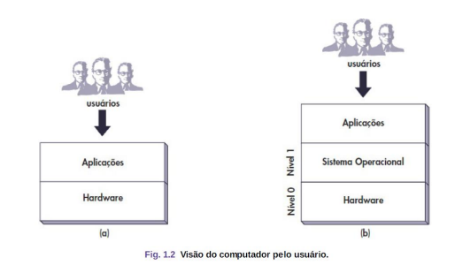
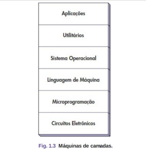
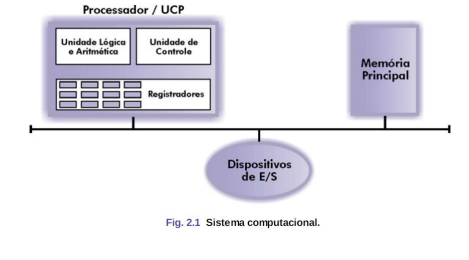
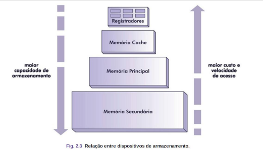
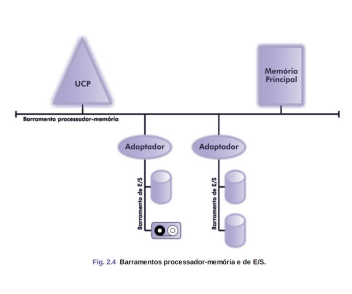
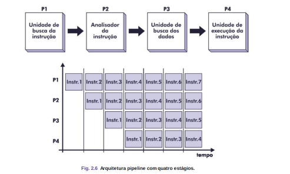

# Conceitos Hardware e Software

## Apresentação

Os computadores são equipados com um dispositivo de **software chamado de sistema operacional**, 
cuja função é fornecer aos programas do usuário e lidar com o gerenciamento de todos os recursos mencionados.
Podemos considerar o computador como uma máquina de níveis ou camadas, 
o **nível 0 (hardware)** e o **nível 1 (sistema operacional)**.

Visão Computacional:

Máquina de Camadas:

---

# Hardware

Um sistema operacional é um conjunto de **circuitos eletrônicos interligados (hardware).**
Todos esses dispositivos manipulam dados na forma digital, maneira confiável de representar e transmitir dados.

## 1. Unidade Central de Processamento(UCP)
Gerencia todo o sistema, controlando as operações de cada unidade.
**Controla e executa instruções presentes na memória principal**.

### 1.1 Composição

* **UC(Unidade de Controle):** gerencia as atividades de todos os componentes do computador.
* **ULA(Unidade Lógica e Aritmética):** realiza operações lógicas (testes e comparações) e aritméticas (cálculos).
* **Registradores:** armazena dados temporariamente, alta velocidade interna, armazenamento reduzido.

## 2. Memória Principal

Local onde são armazenadas instruções e dados.
Classificada em função de sua **volatilidade** (preservação do conteúdo).

* RAM(Random Access Memory): voláteis
* ROM(Read-Only Memory): não voláteis.

### 2.1 Memória Cache

**Memória volátil de alta velocidade**, porém pequeno armazenamento e alto custo.

**Propósito:** minimizar a **disparidade** existente entre a velocidade do processador e a velocidade dos dados na memória principal.

### 2.2 Memoria Secundaria

Não Volátil (a informação não é perdida ao desligar a máquina)
**Acesso lento, porém custo baixo, capacidade maior.**
Ex: Disco Magnético e o Disco Óptico

### 2.3 Relação entre Memórias

## 3. Entrada e Saída (E/S)

Permite comunicação entre o sistema e o mundo externo.

* **Memória Secundária:** discos e fitas magnéticas.
* **Usuário-Máquina:** teclados, monitores, impressoras e plotters.

## 4. Barramento

Meio de comunicação entre as unidades funcionais.
Através de condutores, dados trafegam entre processador, memória e dispositivos E/S.

## 5. Pipelining

Técnica que permite ao processador executar múltiplas.
Instruções paralelamente em estágios diferentes.

## 6. Arquiteturas

### 6.1 RISC(Reduced Intruction Set Computer)

Poucas instruções de máquina, em geral bastante simples, que são executadas diretamente pelo hardware.
Trabalha principalmente com registradores, grande número de processadores, ótima para pipelining.

### 6.2 CISC(Complex Intruction Set Computer)

**Instruções Complexas** interpretadas por microprogramas.
Número reduzido de registradores, difícil implementação de pipelining.

