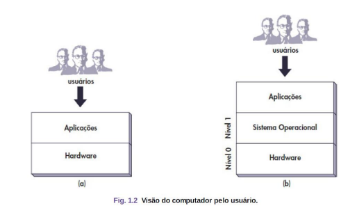
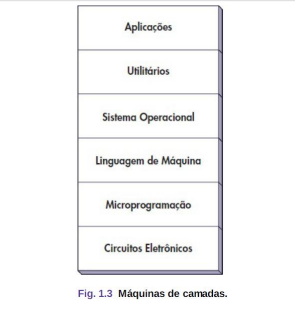

# Conceitos Hardware e Software

## Apresentação

Os computadores são equipados com um dispositivo de **software chamado de sistema operacional**, 
cuja função é fornecer aos programas do usuário e lidar com o gerenciamento de todos os recursos mencionados.
Podemos considerar o computador como uma máquina de níveis ou camadas, 
o **nível 0 (hardware)** e o **nível 1 (sistema operacional)**.

Visão Computacional:

Máquina de Camadas:

---

# Software

Conjunto de programas utilizado como **interface entre as**
**necessidades do usuário e as capacidades do hardware.**
Relacionados mais diretamente com serviços
complementares do sistema operacional
Aplicativos ou apenas aplicações.

## Tradutor

**(Compilador ou Assembler)**
Converte o código escrito em uma linguagem de
programação (como C ou Assembly) para um formato que o
computador pode entender (código de máquina).
Ex: Um compilador pega um código-fonte 
em C e transforma em um programa executável.

## Interpretador

Lê e executa o código linha por linha, sem
convertê-lo totalmente para um arquivo executável.
Ex: O Python usa um interpretador para executar seus
scripts, processando o código diretamente.

## Linker

junta diferentes partes do programa (código
compilado, bibliotecas e módulos) para criar um executável
final.
Ex: Quando você compila um programa em C, o linker
combina o código principal com funções externas para formar
um arquivo pronto para rodar.
