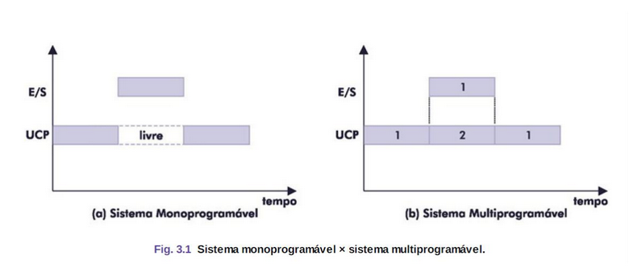

# Tipos de Sistemas

## Concorrência

Sistemas operacionais podem ser vistos como um conjunto de
rotinas executadas de forma concorrente e ordenada

A possibilidade de o processador **executar instruções ao mesmo**
**tempo que outras operações**, como, por exemplo, operações de E/S,
permite que diversas tarefas sejam executadas concorrentemente pelo sistema.

O conceito de concorrência é o princípio básico para o projeto e a
implementação dos sistemas multiprogramáveis.

Os sistemas **Monoprogramáveis e Multiprogramáveis são categorias de S.O**.
que diferem principalmente na forma como utilizam os recursos do computador.

---

## Sistemas Monoprogramáveis

Nos sistemas monoprogramáveis somente um programa pode estar em execução por vez, 
permanecendo o processador dedicado, exclusivamente, a essa tarefa

Podemos observar que, nesse tipo de sistema, **ocorre um desperdício na utilização do processador**,
pois enquanto uma leitura em disco é realizada, ou operações de entrada e saída, o processador permanece ocioso

**O tempo de espera é relativamente longo**, já que as operações com dispositivos de entrada e saída são muito lentas, 
se comparadas com a velocidade do processador em executar instruções.

Também **chamados de monotarefa**, esses sistemas permitem
que apenas um programa seja executado na memória principal por vez.

São comuns em **sistemas antigos ou embarcados**, onde não há
necessidade de multitarefa. Exemplos: **MS-DOS, sistemas embarcados simples.**

---

## Sistemas Multiprogramáveis

Permitem a **execução simultânea de vários programas na memória**, 
melhorando a utilização do processador.

A **CPU alterna entre os programas conforme necessário**,
evitando períodos ociosos enquanto um programa aguarda
operações de entrada e saída.

Aumentam a **eficiência dos recursos computacionais**, pois
reduzem o tempo de inatividade do processador.

São usados em **sistemas modernos, como Windows, Linux e macOS.**

