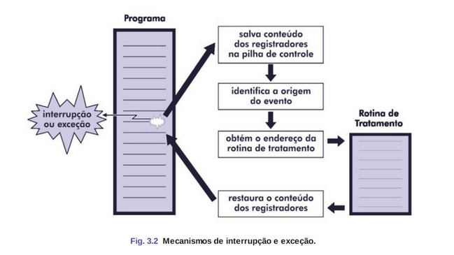

# Tipos de Sistemas

Durante a execução de um programa, eventos inesperados podem ocorrer, causando **desvios no fluxo de execução**.
Esses eventos são chamados de **interrupções ou exceções**, dependendo da origem do evento.

- **Exceções:** são síncronas decorrentes da execução do programa.
- **Interrupções:** são assíncronas ocorrem independentemente da instrução em execução.

---

## Interrupções

- São geradas por **eventos externos ao processador**
- Fundamentais para a implementação de sistemas multiprogramáveis.
- **Permitem a sincronização** do sistema operacional e o controle de dispositivos.

### Funcionamento

- O processador verifica se há interrupções ao final de cada instrução
- Quando uma interrupção ocorre, **o programa em execução é pausado**
- O sistema **desvia o controle para uma rotina de tratamento** de interrupção
- Antes de continuar a execução do programa original, o estado do processador (registradores) precisa ser restaurado.

### Métodos de Tratamento

- **Vetor de interrupção:** Contém os endereços de todas as rotinas de tratamento.
- **Registrador de status:** Armazena o tipo do evento, permitindo que uma única rotina identifique e trate a interrupção.

### Prioridades e Máscaras

- **Interrupções mascaráveis:** Podem ser ignoradas enquanto outra
interrupção está sendo tratada.
- **Interrupções com prioridade:** Algumas interrupções são mais urgentes
e devem ser atendidas primeiro.

---

## Exceções

São geradas por **eventos internos ao processador**, diretamente relacionados à execução do programa. 
Exemplo: divisão por zero ou overflow em uma operação aritmética;

### Funcionamento
- O programa é interrompido e desviado para uma rotina de tratamento de
exceção.
- Cada tipo de exceção **possui uma rotina de tratamento específica**.
- Programadores podem definir mecanismos para lidar com exceções e evitar a interrupção abrupta do programa.