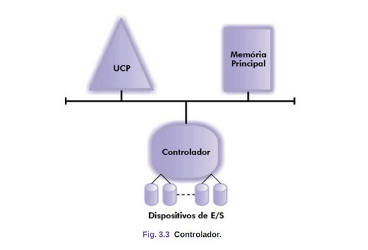
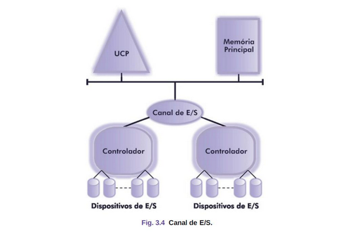
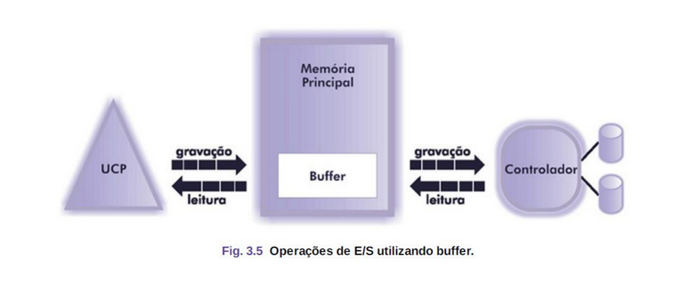
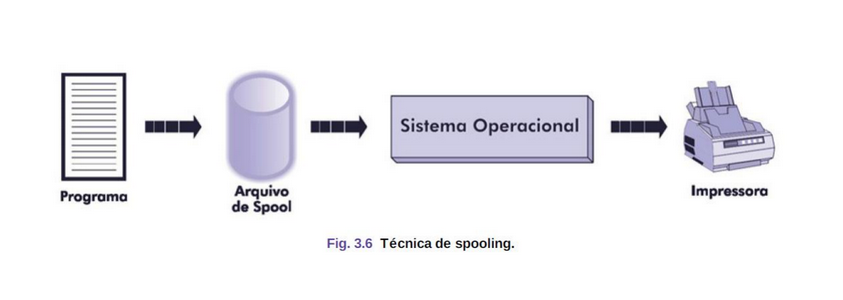

# Tipos de Sistemas

## Operações de E/S

Nos primeiros sistemas, o processador se comunicava
diretamente com os periféricos via **instruções específicas de E/S**

Isso criava uma **forte dependência** entre o processador e os dispositivos de entrada/saída

A introdução dos **controladores de E/S** permitiu a comunicação indireta,
tornando o **processador mais independente** dos dispositivos.

---

## Modelos de Operação de E/S

* **E/S Controlada por Programa (Busy Wait):** O processador inicia a
transferência e **aguarda o término ativamente**, testando continuamente o estado do periférico. 
Ineficiente, pois mantém o processador ocupado sem necessidade.

* **E/S Controlada por Polling:** O processador realiza outras tarefas e
**periodicamente verifica se a operação de E/S foi concluída.** 
Introduz certo grau de paralelismo, permitindo multiprogramação. 
Ineficiente quando há muitos periféricos, pois o processador precisa testar constantemente cada um.

* **E/S Controlada por Interrupção:** O controlador avisa o processador
apenas quando a operação de E/S termina, liberando o processador para
outras tarefas.

* **E/S por Acesso Direto à Memória (DMA - Direct Memory Access):** 
O controlador **transfere dados entre a memória e o periférico sem a intervenção constante do processador**. 
O processador só é acionado no início e no fim da transferência.
    - **Vantagens:** Maior eficiência no processamento. Redução da carga no processador.
    - **Desvantagem:** O processador perde temporariamente o controle do barramento durante a transferência.

---

## Canal de Entrada/Saída

Introduzido pela IBM no Sistema 7094

* Funciona como um **processador auxiliar** especializado em E/S.
    - Pode **executar programas de E/S** armazenados na memória.
    - **Controla múltiplos dispositivos** através de diversos controladores.
    - **Reduz a intervenção da CPU** no gerenciamento de dispositivos.

A evolução do canal resultou no processador de entrada e saída, 
que possui sua própria memória e controla as operações de E/S 
com **mínima interferência do processador principal**.

---

## Buffering

O buffering utiliza uma **área na memória principal chamada buffer**
para intermediar a transferência de dados entre os dispositivos de entrada/saída e a memória

* **Leitura:** Os dados são transferidos **primeiro para o buffer**, liberando
o dispositivo para realizar uma nova leitura enquanto o processador manipula os dados armazenados.

* **Gravação:** O processador armazena os dados no buffer antes que
sejam gravados no dispositivo de saída.

**Minimizar a disparidade entre a velocidade do processador e dos dispositivos de E/S.** 

Manter o processador e os dispositivos de E/S ocupados a maior parte do tempo, evitando ociosidade.

---

## Spooling - Simultaneous Peripheral Operation On-Line

Criada no final dos anos 1950 para aumentar a **concorrência e a eficiência dos sistemas** operacionais.

**Armazena temporariamente** os dados de entrada/saída em um dispositivo de armazenamento (como disco), 
permitindo que o processador execute outras tarefas simultaneamente.

**Gerenciamento de Impressão**: Quando um programa envia um documento para impressão, 
os dados são armazenados em um arquivo de spool no disco. 
O sistema operacional **gerencia a fila de impressão**, liberando o programa para outras atividades.

**Evita que um único programa monopolize a impressora.**

