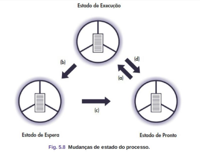
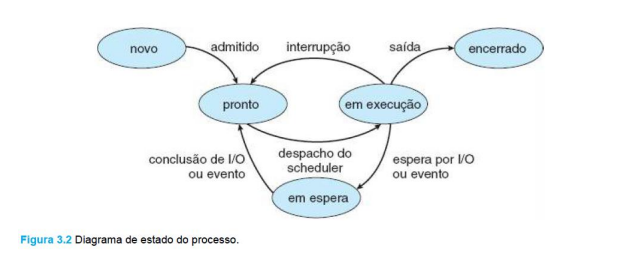
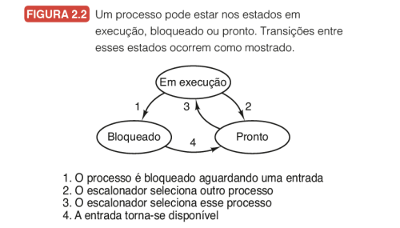

# Processos

## Introdução

* **Cada programa em execução é tratado como um processo.** 

Representando uma **unidade fundamental** de trabalho em um sistema operacional.

Quando um programa é iniciado, ele se torna um processo e começa a ser **gerenciado pelo sistema operacional**.

A gerência de processos permite:

* **Compartilhamento de dados**
* **Alocação de recursos**
* **Comunicação e sincronização** entre programas
* Permite a **execução controlada** de vários programas ao mesmo tempo
* Torna possível que múltiplos usuários utilizem o sistema como se tivessem controle exclusivo dos recursos.

---

## Estados do Processo

Em um sistema multiprogramável, um processo **não deve alocar exclusivamente a UCP**, 
de forma que exista um compartilhamento no uso do processador

Os processos passam por **diferentes estados ao longo do seu processamento**, 
em função de eventos gerados pelo sistema operacional ou pelo próprio processo

Um processo ativo pode encontrar-se em três diferentes estados

* **Execução:** Está utilizando a UCP (processador).
* **Pronto:** Aguardando para ser executado.
* **Espera:** Aguardando por algum evento externo ou por algum recurso para prosseguir seu processamento

* Exemplo:
    - Processo solicita uma leitura de arquivo **→ entra em espera.**
    - Quando a leitura termina **→ volta ao estado pronto.**

### Execução (running)

Um processo é dito no estado de execução quando está sendo **processado pela UCP**.

Em sistemas com **apenas uma UCP, somente um processo** pode estar sendo executado em um dado instante de tempo.
Os **processos se alternam** na utilização do processador seguindo uma política estabelecida pelo S. O.

Em sistemas com **múltiplos processadores**, existe a possibilidade de **mais de um processo ser executado** ao mesmo tempo.
Neste tipo de sistema, também é possível um mesmo processo ser executado simultaneamente em mais de uma UCP **(processamento paralelo).**

### Pronto (ready)

Um processo está no estado de pronto quando **aguarda apenas para ser executado**.

O **S.O é responsável por determinar a ordem** e os critérios pelos quais os processos em estado de pronto devem fazer uso do processador. 

**Este mecanismo é conhecido como escalonamento**

Em geral existem vários processos no sistema no estado de pronto **organizados em listas encadeadas**.

Os processos devem estar ordenados pela sua importância, permitindo que **processos mais prioritários sejam selecionados primeiramente para execução.**

### Espera (wait)

Um processo no estado de e**spera aguarda por algum evento externo** ou por algum recurso para prosseguir seu processamento.

Como exemplo, o **término de uma operação de E/S** ou a espera de uma determinada data e/ou hora para continuar sua execução.

Em alguns sistemas operacionais, o estado de espera pode ser chamado de **bloqueado (blocked).**

O sistema organiza os vários processos no estado de espera também em **listas encadeadas**.

### Mudanças de Estado do Processo

As mudanças de estado ocorrem conforme eventos internos ou
externos ao processo:

* **Pronto → Execução:** o escalonador do SO seleciona o processo.
* **Execução → Espera:** o processo solicita um recurso.
* **Espera → Pronto:** o recurso é disponibilizado.
* **Execução → Pronto:** o tempo de CPU termina.

#### Diagrama de Silberschatz

#### Diagrama de Tanenbaum

---

## Processos CPU-bound e I/O-bound

Processos podem ser classificados de acordo com a utilização
do processador e dos dispositivos de E/S.

**CPU-bound (ligado à UCP):** quando passa a **maior parte do tempo no estado de execução**, 
utilizando o processador, ou pronto. Realiza poucas operações de leitura e gravação, 
e é encontrado em aplicações científicas que efetuam muitos cálculos

**I/O-bound (ligado à E/S):** quando passa a **maior parte do tempo no estado de espera**, 
pois realiza um elevado número de operações de E/S. É encontrado em aplicações comerciais,
que se baseiam em leitura, processamento e gravação.
Os processos interativos também são bons exemplos de processos I/O-bound, 
pela forma de comunicação entre o usuário e o sistema.
