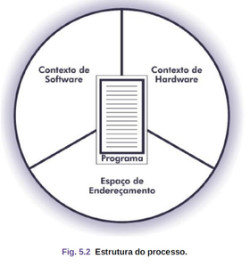
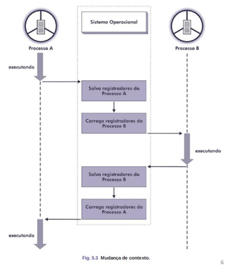
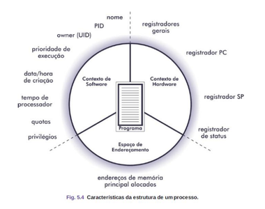

# Processos

## Introdução

* **Cada programa em execução é tratado como um processo.** 

Representando uma **unidade fundamental** de trabalho em um sistema operacional.

Quando um programa é iniciado, ele se torna um processo e começa a ser **gerenciado pelo sistema operacional**.

A gerência de processos permite:

* **Compartilhamento de dados**
* **Alocação de recursos**
* **Comunicação e sincronização** entre programas
* Permite a **execução controlada** de vários programas ao mesmo tempo
* Torna possível que múltiplos usuários utilizem o sistema como se tivessem controle exclusivo dos recursos.

---

## Estrutura de um Processo

**Um processo é composto por três partes principais:**

### Contexto de Hardware

Guarda o estado do processador quando o processo é interrompido.

Inclui registradores como:
- **PC (Program Counter):** endereço da próxima instrução.
- **SP (Stack Pointer)**: ponteiro da pilha.
- **Registrador de Status**

**Importante:** Quando um processo é pausado, esses valores são salvos. 
Quando retomado, são recarregados. Isso é chamado de mudança de contexto.

### Contexto de Software

Contém informações administrativas do processo:
- **PID (Identificação do processo)**
- **UID (Identificação do usuário)**
- **Prioridade**
- **Recursos alocados (memória, arquivos, etc.)**

* Grupos do Contexto de Software:
    - **Identificação:** PID, UID, processo pai.
    - **Quotas:** limites de uso dos recursos do sistema.
    - **Privilégios:** ações que o processo pode realizar.

### Espaço de Endereçamento

Área da memória usada por um processo para armazenar

- Instruções do programa
- Dados em tempo de execução
- Pilha de chamadas (stack)

### Bloco de Controle do Processo (PCB)

Estrutura **usada pelo S.O** para representar cada processo.

**Armazena o contexto** de hardware, software e o espaço de endereçamento.

O PCB de cada processo reside em uma **área protegida da memória.**

* No Linux: comando **ps** mostra PID, prioridade, tempo de CPU.
* No Windows: usar o **Gerenciador de Tarefas**.

---

## Ciclo do Processo

Quatro **eventos principais** fazem com que os processos sejam criados:

1. Inicialização do sistema.
2. Execução de uma chamada de sistema de criação de processo por um processo em execução.
3. Solicitação de um usuário para criar um novo processo.
4. Início de uma tarefa em lote.

### Criação e Eliminação de Processos

O término de processos normalmente ocorre devido a uma das
condições a seguir:
1. Saída normal (voluntária).
2. Erro fatal (involuntário).
3. Saída por erro (voluntária).
4. Morto por outro processo (involuntário).

* **Foreground (Primeiro Plano):** Comunicação direta do usuário com o processo durante o seu processamento. Exemplo: Terminal com teclado, mouse e monitor, permitindo.

* **Background (Segundo Plano):** Não requer interação direta com o usuário durante sua execução. 
Não está associado a dispositivos interativos, geralmente utiliza arquivos de entrada e saída (E/S redirecionada).
Muito comum em tarefas automáticas, serviços e processos em lote (batch).

### Processos do Sistema Operacional
- auditoria e segurança;
- serviços de rede;
- contabilização do uso de recursos;
- contabilização de erros;
- gerência de impressão;
- gerência de jobs batch;
- Temporização (ex: relógio do sistema);
- comunicação de eventos (ex: plugar um USB);
- interface de comandos (shell).